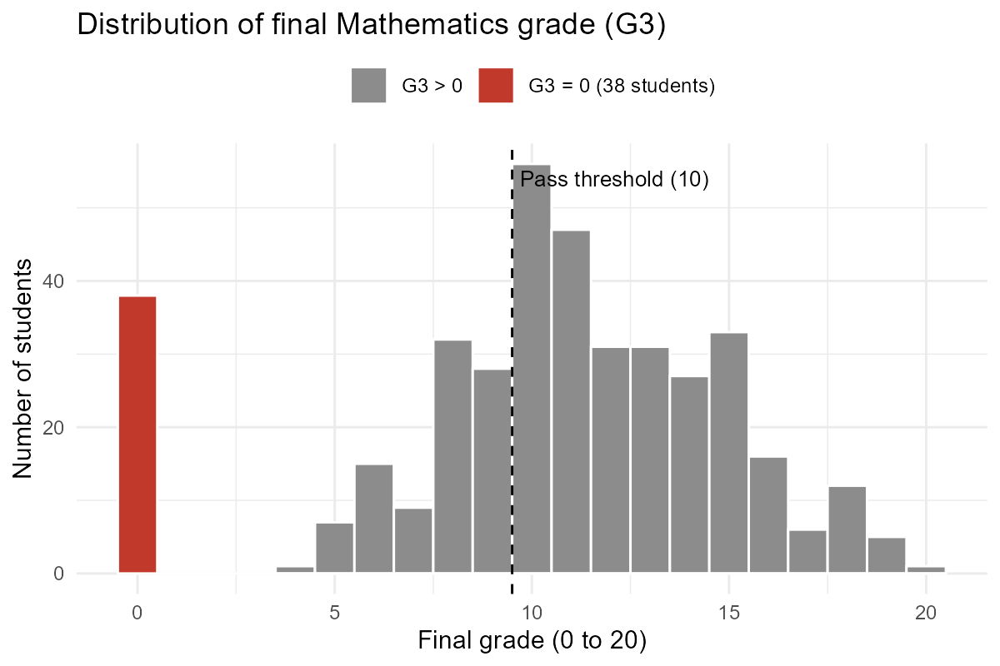
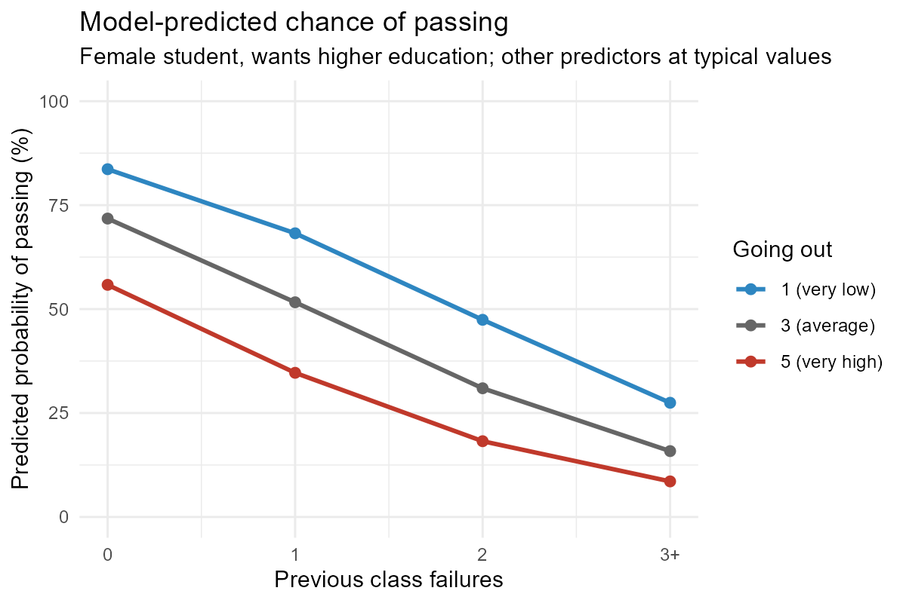

# Understanding Student Performance in Mathematics

**LEAP | Data Analytics and Statistics with Applications | Final Project, Scenario 2**
Tarık Beyhan, October 2026

**Quick links:** [Analytical report (PDF)](report/report.pdf) · [Decision-maker presentation (PDF)](presentation/decision_maker_presentation.pdf) · [PowerPoint version](presentation/decision_maker_presentation.pptx) · [R analysis script](student_performance_analysis.R) · [Full R output (PDF)](report/analysis_output.pdf)

## 1. Project and scenario

This portfolio presents my analysis for Scenario 2, *Understanding Student Performance*. Using records and questionnaire answers for 395 students in two Portuguese secondary schools, I examine which student characteristics are associated with the final Mathematics grade and with the risk of failing, and what can and cannot be concluded from these data.

## 2. Research question

Which student characteristics are associated with final Mathematics performance, which factors are linked to the risk of failing, and what conclusions can reasonably be drawn from the data?

## 3. Data

- **Source:** UCI Machine Learning Repository, Student Performance dataset, Mathematics course file (`student-mat.csv`). Cortez, P. (2008), https://doi.org/10.24432/C5TG7T
- **Size:** 395 students (one row per student), 33 variables, collected in 2005 to 2006.
- **Outcomes:** final grade `G3` (0 to 20) and a pass/fail indicator (Pass if `G3` >= 10). Earlier grades `G1` and `G2` are not used as predictors.
- **Data quality:** no missing values or duplicates. 38 students have a final grade of 0 and all of them have zero recorded absences; they most likely did not sit the final assessment. Their influence is tested in a sensitivity analysis.
- **Ethics:** the data concern minors and include sensitive items (alcohol use, relationships, family situation). Results are reported only as group-level associations and should be used to offer support, not to label individual students.

## 4. Analysis workflow

All steps are in `student_performance_analysis.R`, organised by the six project questions:

1. Import, type conversion, data-quality checks, investigation of the zero-grade group.
2. Descriptive statistics, frequency tables and exploratory plots.
3. Pearson and Spearman correlations, contingency tables with conditional percentages, chi-squared and Fisher tests.
4. Multiple linear regression for `G3` and logistic regression for passing, both with seven predictors: previous failures, mother's education, going out, study time, absences, sex and wish for higher education.
5. Residual diagnostics, variance inflation factors, confidence intervals, and a sensitivity analysis excluding the 38 zero-grade students.
6. Discussion of causality, confounding, measurement and generalisation (in the report).

## 5. Key results

| Finding | Evidence |
|---|---|
| Previous failures is the strongest and most robust correlate | Each failure: about 1.8 points lower grade (95% CI -2.4 to -1.2); odds of passing x 0.42 (0.29 to 0.59) |
| Going out often and lower maternal education go with modestly lower grades | About 0.5 points per scale step; stable when zero-grade students are excluded |
| Pass rate falls sharply with past failures | 75% with none, 48% with one, 21% with two or more |
| The models explain little of the variation | R-squared = 0.19; the logistic model detects only 35% of actual fails |
| Absences matter once non-completers are set aside | Coefficient changes from +0.04 (not significant) to -0.07 per absence (p < 0.001) |

## 6. Interpretation and limitations

The data are observational, cross-sectional and partly self-reported, so all results are associations, not causal effects. Important factors such as prior ability, teaching and household income are not measured, and previous failures is best seen as a marker of earlier difficulties. Results for absences, study time, sex and higher-education plans depend on how the 38 non-completers are treated. The sample covers two schools in one country, one year and one subject, so findings may not generalise.

The association with previous failures is both statistically convincing (95% CI -2.4 to -1.2 points) and practically important, as it can move a student from pass to fail; the links with going out and maternal education are statistically detectable but small (about half a grade point per step). Unmeasured confounders such as prior ability, teaching quality and household income may explain part of all these associations, and the models leave more than 80% of the variation in grades unexplained.

## 7. Decision-maker presentation

A six-slide presentation for school decision-makers summarises the findings, their practical meaning, the main uncertainties and what should not be concluded: [PDF](presentation/decision_maker_presentation.pdf) | [PowerPoint](presentation/decision_maker_presentation.pptx).

## 8. Reflection

The most valuable step was checking the data before modelling: the unusual group of zero grades with zero absences turned out to change several conclusions, which I would have missed by running the starter models directly. The hardest part was interpretation rather than code: keeping associations separate from causes, and translating odds ratios into probabilities that a non-specialist can use. With more time I would treat the ordered variables as categories rather than linear scores, model the non-completers separately (for example, completion first, then grade among completers), validate the models on held-out data, and compare results with the Portuguese-language course file.

## Files

| File | Content |
|---|---|
| [`student_performance_analysis.R`](student_performance_analysis.R) | Complete, commented analysis script |
| [`student-mat.csv`](student-mat.csv) | Dataset (UCI, semicolon separated, CC BY 4.0) |
| [`report/report.pdf`](report/report.pdf) | Analytical report (6 pages + appendices) |
| [`report/analysis_output.pdf`](report/analysis_output.pdf) | Script compiled with code and all output (File → Compile Report) |
| [`presentation/`](presentation/) | Decision-maker presentation (PowerPoint and PDF) |
| [`figures/`](figures/) | All figures produced by the script |
| [`results/`](results/) | Key result tables (CSV) and R session info |

## How to reproduce

1. Download or clone this repository and keep `student_performance_analysis.R` and `student-mat.csv` in the same folder.
2. Open the script in RStudio and set the working directory to that folder (*Session → Set Working Directory → To Source File Location*).
3. Run the whole script (*Source*), or in the console: `source("student_performance_analysis.R", echo = TRUE)`.

The script installs `ggplot2`, `dplyr` and `broom` if they are missing, and writes all figures to `figures/` and result tables to `results/`. The analysis was run with R 4.6.1 on Windows 11. (see `results/session_info.txt`) To produce a PDF with code and output, use *File → Compile Report → PDF* (requires LaTeX, e.g. `tinytex::install_tinytex()`).
